# TP3 : Microservices « Calculatrice » avec Spring Boot

**Matière :** Architecture MicroServices | **Filière :** MPSRCC1
**Étudiante :** Fatma Cherif | **Année universitaire :** 2026-2027

## 1. Structure du dépôt

```
tp3/
├── calcul-service/        (port 8081)
├── historique-service/    (port 8082)
├── captures/
└── README.md
```

## 2. Partie A : Questions de conception

1. **Avantage / inconvénient du calcul par requête HTTP.**
   Avantage : `calcul-service` est indépendant, on peut le développer, le redéployer ou le multiplier sans toucher à `historique-service`.
   Inconvénient : un appel réseau est plus lent qu'un appel de méthode, et `historique-service` dépend de la disponibilité de `calcul-service`.
2. **Si `calcul-service` est arrêté.**
   Continuent de fonctionner : `GET /operations`, `GET /operations/{id}` et `DELETE /operations/{id}` (elles lisent ou suppriment seulement des données en mémoire).
   Échouent : `GET /calcul/*` (service arrêté), `POST /operations` et `PUT /operations/{id}` (elles ont besoin d'un calcul).
3. **Même port impossible.** Un port ne peut être écouté que par un seul processus à la fois. Le second démarrage échoue avec « Port already in use ».
4. **Code de statut.** **503 Service Unavailable** : le client n'a rien fait de faux et le serveur n'a pas de bug, mais il ne peut pas joindre un service dont il dépend.

## 3. Partie B : Création de `calcul-service`

Projet généré avec Spring Initializr : Maven, Java [17 ou 21], Spring Boot 4.0.9, Group `com.exemple`, Artifact `calcul-service`, Package `com.exemple.calcul`, Packaging Jar, dépendance Spring Web.

Structure :
```
com.exemple.calcul
├── CalculServiceApplication
├── controller/CalculController
├── service/Calculatrice
└── model/Resultat
```

## 4. Partie C : Premier microservice

### Lancement de calcul-service

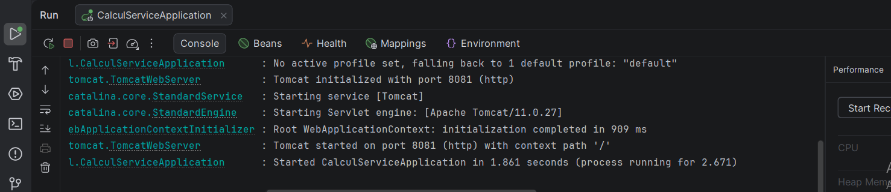

Le Tomcat embarqué démarre sur le port 8081.

### Tableau de correspondance Spring / JAX-RS

| Spring (TP3) | JAX-RS (TP2) | Rôle dans cet exemple |
|---|---|---|
| `@RestController` | (pas d'équivalent direct) | Déclare la classe comme contrôleur REST : la valeur retournée devient le corps de la réponse |
| `@RequestMapping("/calcul")` | `@Path("/calcul")` sur la classe | URI de base de toutes les méthodes du contrôleur |
| `@GetMapping("/somme")` | `@GET` + `@Path("/somme")` | Méthode qui répond à `GET /calcul/somme` |
| `produces = MediaType.TEXT_PLAIN_VALUE` | `@Produces(MediaType.TEXT_PLAIN)` | La réponse est du texte brut |
| `@RequestParam("a") int a` | `@QueryParam("a") int a` | Lit le paramètre `a` dans `?a=2&b=3` |
| `ResponseEntity.ok(...)` | `Response.ok(...).build()` | Construit une réponse de statut 200 |

### Origine des parties de l'URL `http://localhost:8081/calcul/somme?a=2&b=3`

| Partie | Origine |
|---|---|
| `localhost:8081` | Machine locale et port fixé par `server.port` dans `application.properties` |
| `/calcul` | `@RequestMapping("/calcul")` de la classe |
| `/somme` | `@GetMapping("/somme")` de la méthode |
| `?a=2&b=3` | Paramètres de requête, lus par `@RequestParam` |

**Question C.1.** Ont disparu : `RestWebApp` (nom de l'application `.war` déployée dans Tomcat) et `/api` (`@ApplicationPath`). Un microservice est une application autonome avec son propre Tomcat embarqué : il n'y a plus de `.war` à déployer, donc plus de nom d'application, et plus de classe d'activation JAX-RS.

### Tests

Test dans le navigateur : `http://localhost:8081/calcul/somme?a=2&b=3`

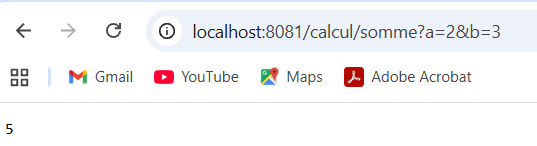

**Question C.2.** Un `POST` sur `/calcul/somme` renvoie le statut **[405 Method Not Allowed : à vérifier sur ta capture]**, car la méthode n'est mappée que sur `GET`. [Au TP2, le statut était **[à comparer avec ton TP2]**.]

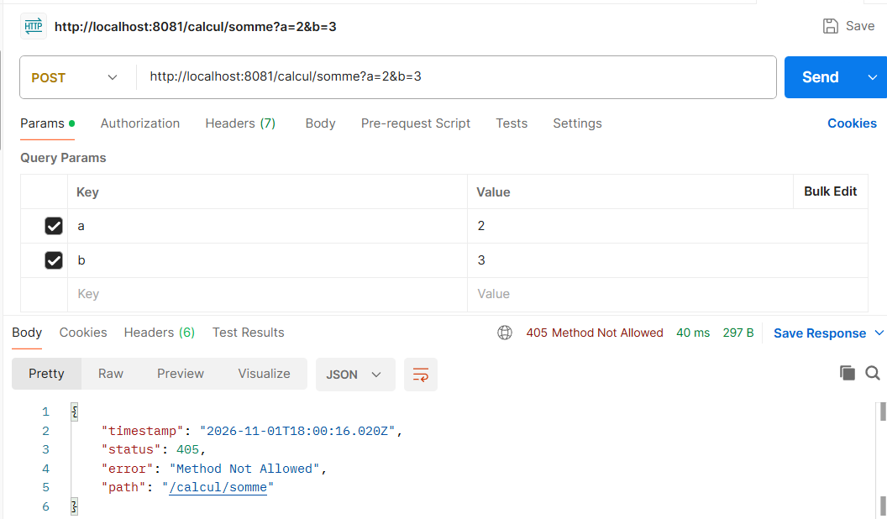

## 5. Partie D : Calculatrice complète

| Requête | Statut | Corps |
|---|---|---|
| `GET /calcul/soustraction?a=10&b=4` | 200 | `6` |
| `GET /calcul/produit?a=6&b=7` | 200 | `42` |
| `GET /calcul/division?a=7&b=2` | 200 | `3.5` |
| `GET /calcul/division?a=7&b=0` | 400 | `Erreur : division par 0 impossible` |
| `GET /calcul/produit/6/7` | 200 | `42` |

Division par zéro :

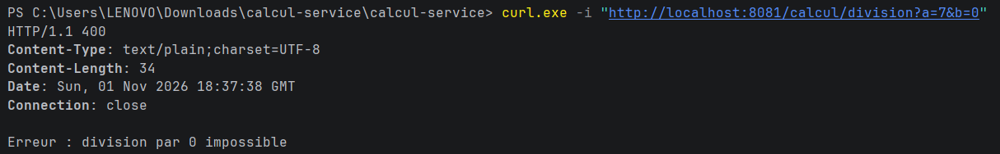

### Observations (D.3)

Paramètre `b` absent, puis paramètre `a` non entier :

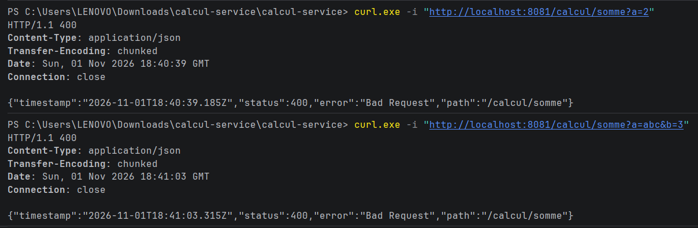

**Question D.1.** Spring renvoie **400 Bad Request** quand un paramètre est absent ou n'est pas un entier : la méthode n'est pas exécutée. Au TP2, JAX-RS donnait 0 à un entier absent et calculait quand même. L'attitude de Spring est la plus conforme à REST : une requête incomplète ou invalide est une erreur du client, et on le lui signale au lieu de produire un résultat faux.

**Question D.2.** Le JSON d'erreur contient les champs : **[timestamp, status, error, path : à vérifier sur ta capture]**.

**Question D.3.**

| Spring | JAX-RS |
|---|---|
| `@RequestParam` | `@QueryParam` |
| `@PathVariable` | `@PathParam` |

Pour lire l'identifiant dans `/operations/{id}`, on utilise **`@PathVariable`**, car `id` fait partie du chemin et non d'une chaîne de requête.

## 6. Partie E : Échanger des données en JSON

`GET /calcul/somme/detail?a=2&b=3` :

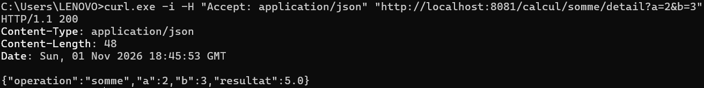

### En-tête Accept

Requête avec `Accept: application/json` (200), puis avec `Accept: application/xml` (406) :

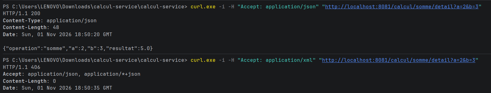

**Question E.1.** Oui, les deux JSON sont équivalents pour un client : un objet JSON est un ensemble de paires clé/valeur non ordonnées, seul le contenu compte. Cette fois, la conversion a été faite par **Jackson**, inclus dans `spring-boot-starter-webmvc` (au TP2, c'était JSON-B).

**Question E.2.** Spring compare l'en-tête `Accept` du client avec les formats que l'application sait produire. Jackson ne produit que du JSON et aucun convertisseur XML n'est présent, donc aucun format ne convient : Spring répond **406 Not Acceptable**, même si le code ne mentionne aucun format.
## 7. Partie F : `historique-service`

### Démarrage des deux microservices

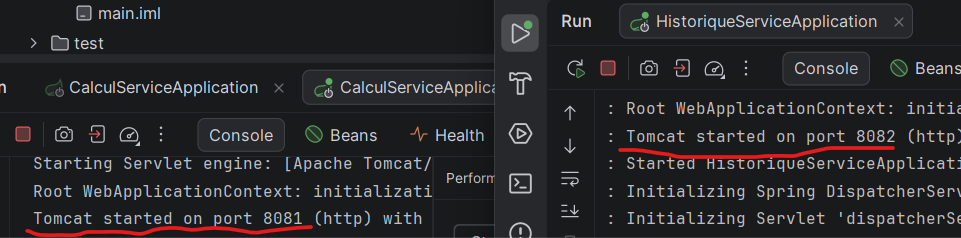

`calcul-service` écoute sur le port 8081 et `historique-service` sur le port 8082.

### Structure

```
com.exemple.historique
├── HistoriqueServiceApplication
├── controller/OperationController
├── service/OperationService
├── client/CalculClient
└── model/Operation
```

### F.6 Création et lecture

| N° | Requête | Corps envoyé | Statut | Corps obtenu |
|---|---|---|---|---|
| 1 | POST `/operations` | `{"operateur":"somme","a":8,"b":2}` | 201 | `{"id":1,"operateur":"somme","a":8,"b":2,"resultat":10.0}` |
| 2 | POST `/operations` | `{"operateur":"division","a":7,"b":2}` | 201 | `{"id":2,...,"resultat":3.5}` |
| 3 | GET `/operations` | aucun | 200 | tableau des 2 opérations |
| 4 | GET `/operations/2` | aucun | 200 | l'opération 2 |
| 5 | GET `/operations/99` | aucun | 404 | (vide) |
| 6 | POST `/operations` | `{"operateur":"division","a":7,"b":0}` | 400 | `{"erreur":"Calcul impossible (division par 0 ?)"}` |
| 7 | POST `/operations` | `{"operateur":"racine","a":9,"b":0}` | 400 | `{"erreur":"Opérateur inconnu : racine"}` |

Test 1 (création, statut 201) :
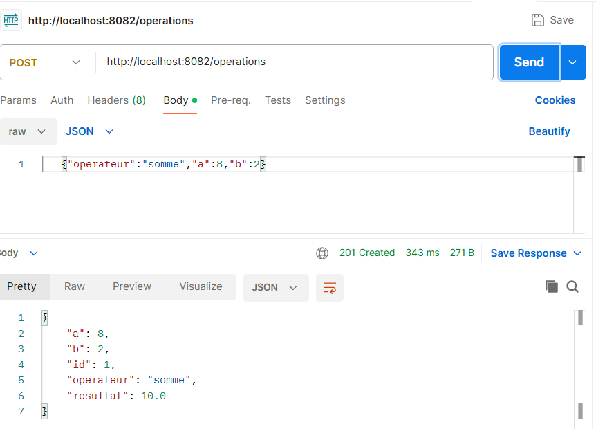

Test 3 (lecture de la liste) :
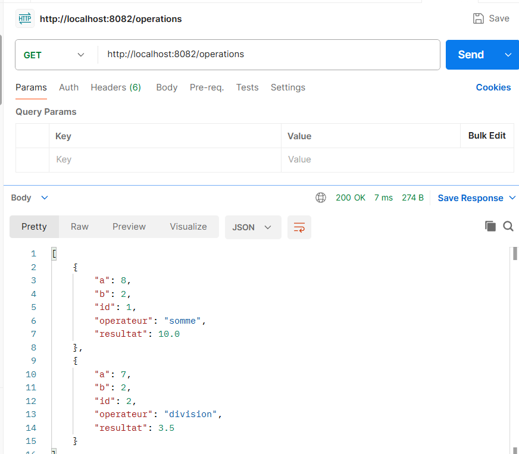

Test 6 (division par zéro) :
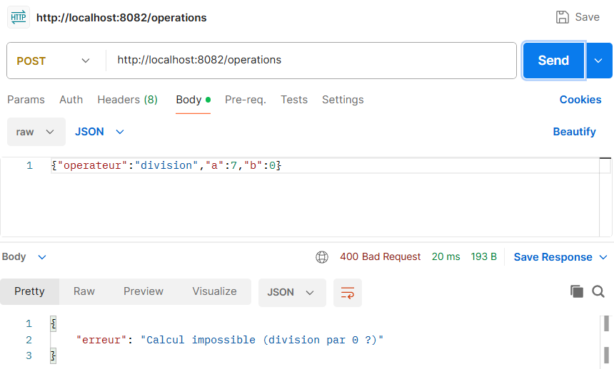

Après le test 1, la console de `calcul-service` affiche `somme(8,2)` : la requête passe bien par lui.

### F.7 Arrêt de `calcul-service`

| N° | Requête | Corps envoyé | Statut | Corps obtenu |
|---|---|---|---|---|
| 8 | GET `/operations` | aucun | 200 | la liste |
| 9 | GET `/operations/1` | aucun | 200 | l'opération 1 |
| 10 | POST `/operations` | `{"operateur":"produit","a":3,"b":4}` | 503 | `{"erreur":"calcul-service est indisponible"}` |

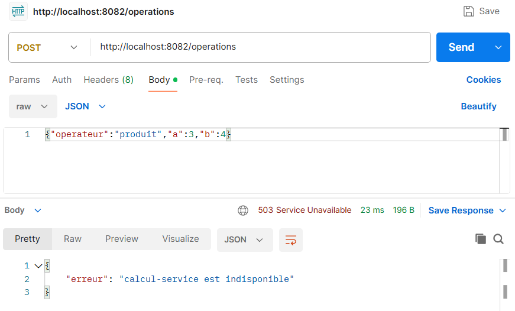

Après le redémarrage de `calcul-service`, le test 10 renvoie **201** avec l'identifiant **3** : les échecs n'ont pas consommé d'identifiant, car `ajouter` n'est appelé qu'après un calcul réussi.

**Question F.1.** Les lectures (`GET`) ne demandent aucun calcul : les opérations sont stockées dans la mémoire d'`historique-service`, qui n'a pas besoin de `calcul-service` pour les relire. Au TP2, cette situation était impossible : un seul `.war` contenait tout, donc si l'application s'arrêtait, tout s'arrêtait avec elle.

**Question F.2.** Sans le bloc `catch (ResourceAccessException e)`, l'exception levée par `RestClient` quand `calcul-service` est injoignable n'est traitée nulle part dans le contrôleur. Elle remonte jusqu'à Spring, qui répond **500 Internal Server Error** : le client croit à un bug d'`historique-service`, alors que le vrai problème est l'indisponibilité d'un service dont il dépend. Avec le `catch`, on renvoie **503 Service Unavailable** avec un message clair.

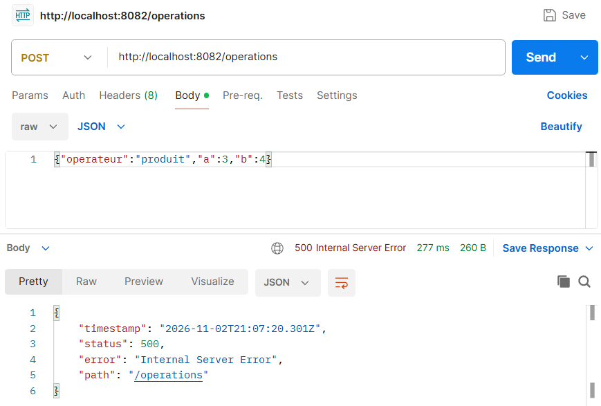

### F.8 Modifier une opération (PUT)

| Situation | Statut | Corps de la réponse |
|---|---|---|
| Aucune opération ne porte cet identifiant | 404 | `{"erreur":"Opération introuvable : 99"}` |
| Le calcul est impossible (division par 0) | 400 | `{"erreur":"Calcul impossible (division par 0 ?)"}` |
| `calcul-service` est injoignable | 503 | `{"erreur":"calcul-service est indisponible"}` |
| Modification réussie | 200 | `{"id":1,"operateur":"produit","a":8,"b":2,"resultat":16.0}` |

| N° | Requête | Corps envoyé | Statut obtenu |
|---|---|---|---|
| 11 | PUT `/operations/1` | `{"operateur":"produit","a":8,"b":2}` | 200 |
| 12 | GET `/operations/1` | aucun | 200 (résultat 16.0) |
| 13 | PUT `/operations/99` | `{"operateur":"produit","a":8,"b":2}` | 404 |
| 14 | PUT `/operations/1` | `{"operateur":"division","a":8,"b":0}` | 400 |
| 15 | PUT `/operations/1` (`calcul-service` arrêté) | `{"operateur":"produit","a":8,"b":2}` | 503 |

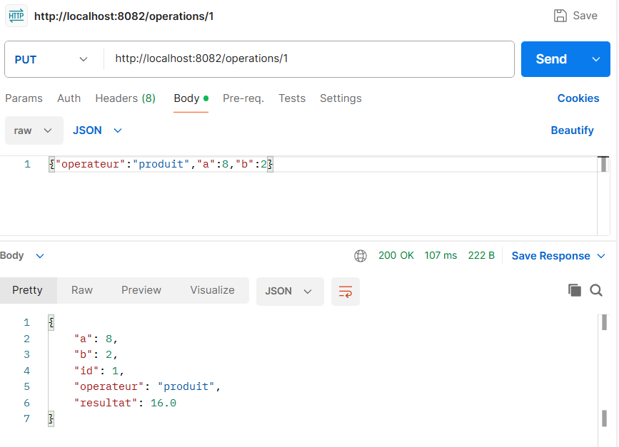
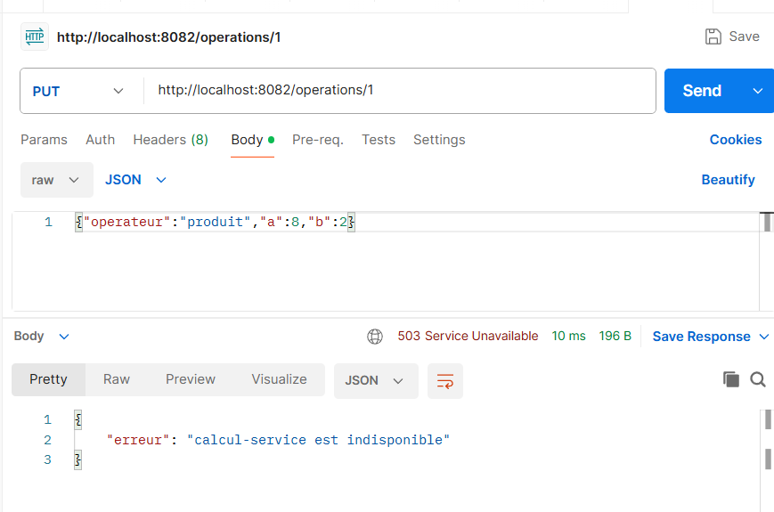

### F.9 Supprimer une opération (DELETE)

| Situation | Statut | Corps de la réponse |
|---|---|---|
| Aucune opération ne porte cet identifiant | 404 | `{"erreur":"Opération introuvable : 1"}` |
| Suppression réussie | 204 | (vide) |

| N° | Requête | Statut obtenu |
|---|---|---|
| 16 | DELETE `/operations/1` | 204 |
| 17 | GET `/operations/1` | 404 |
| 18 | DELETE `/operations/1` | 404 |

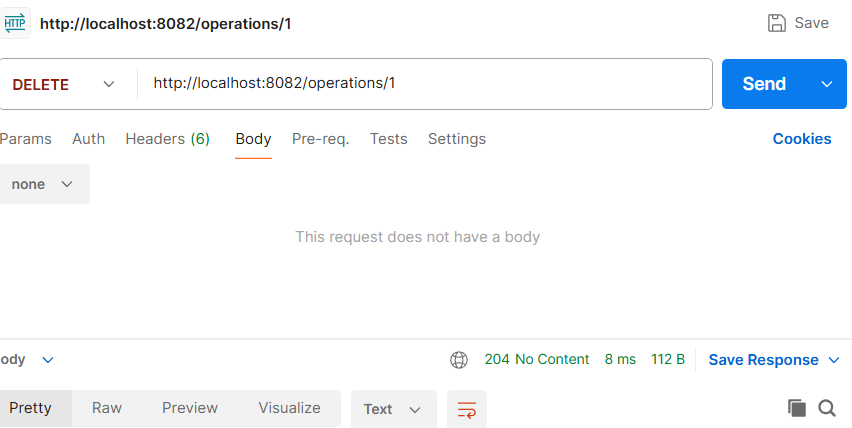

## 8. Questions de synthèse

**1. Où a-t-on observé chaque différence du tableau A.3 ?**

| Aspect | Étape d'observation |
|---|---|
| Technologie (Spring Boot) | B.3 (`pom.xml`) |
| Découpage en deux applications | Parties B et F (deux projets) |
| Résultat de la construction (`.jar`) | B.3 et C.5 |
| Serveur (Tomcat embarqué) | C.5 (`Tomcat started on port 8081`) |
| Port | C.4 (`server.port`) |
| Adresse | C.6 |
| Activation | B.4 (`@SpringBootApplication`) |
| Ressource REST | C.2 (`@RestController`, `@RequestMapping`) |
| Verbes HTTP | C.2, F.5, F.8, F.9 |
| Paramètres | C.2, D.4, F.5 |
| Réponse HTTP | C.2, D.2 (`ResponseEntity`) |
| Conversion JSON | Partie E (Jackson) |
| Création des objets | C.1, F.4 (`@Service`, injection par constructeur) |
| Communication | F.3 (`CalculClient`, requête HTTP) |

**2. Correspondance JAX-RS / Spring.**

| JAX-RS (TP2) | Spring (TP3) |
|---|---|
| `@ApplicationPath` + `RestApplication` | `@SpringBootApplication` + `main` |
| `@Path` sur la classe | `@RestController` + `@RequestMapping` |
| `@Path` sur la méthode | chemin dans `@GetMapping("/...")` |
| `@GET`, `@POST`, `@PUT`, `@DELETE` | `@GetMapping`, `@PostMapping`, `@PutMapping`, `@DeleteMapping` |
| `@QueryParam` | `@RequestParam` |
| `@PathParam` | `@PathVariable` |
| `@Consumes` (corps JSON) | `@RequestBody` |
| `@Produces` | `produces = ...` |
| `Response` | `ResponseEntity` |
| `UriInfo` (`getAbsolutePathBuilder`) | `ServletUriComponentsBuilder` |
| JSON-B | Jackson |

**3. Construire et lancer sans IntelliJ.** Dans un premier terminal :

```bash
cd calcul-service
mvn clean package
java -jar target/calcul-service-0.0.1-SNAPSHOT.jar
```

Dans un second terminal :

```bash
cd historique-service
mvn clean package
java -jar target/historique-service-0.0.1-SNAPSHOT.jar
```

Il n'y a plus de déploiement : chaque `.jar` contient l'application et son Tomcat, et se lance seul. Chaque service reste actif tant que son terminal est ouvert (arrêt avec Ctrl + C).

**4. Microservice et service web.** Un microservice est un service web : `calcul-service` expose une API HTTP (URI, verbes, JSON). Un service web n'est pas toujours un microservice : le `RestWebApp.war` du TP2 était un service web, mais monolithique : calcul et historique vivaient dans la même application, déployée dans un Tomcat partagé. Un microservice ajoute l'autonomie (serveur embarqué, port propre, développement et déploiement indépendants) et une responsabilité unique.

**5. Adresse en dur dans `application.properties`.** Avec trois exemplaires de `calcul-service`, `historique-service` ne connaît qu'une seule adresse (`http://localhost:8081`) : toute la charge va vers un seul exemplaire, et les deux autres ne servent à rien. Si cet exemplaire s'arrête, les appels échouent même si les autres fonctionnent. Il faudrait un mécanisme qui connaisse les adresses des exemplaires actifs et répartisse les appels (découverte de services et équilibrage de charge, vus au TP4).

**6. Principe stateless.** Ce principe interdit de mémoriser l'**état de la conversation** d'un client (par exemple une session) : chaque requête doit contenir tout ce qu'il faut pour être traitée. La liste des opérations est autre chose : c'est l'**état des ressources** de l'application, partagé par tous les clients, comme le contenu d'une base de données. Le serveur ne retient rien de ce que tel client a fait avant, donc le principe est respecté.

**7. Répétition de POST et de PUT.**
- Deux `POST /operations` identiques créent **deux opérations différentes** (ids 1 et 2) : POST n'est **pas idempotent**.
- Deux `PUT /operations/1` identiques laissent la ressource **dans le même état** (même résultat 16.0) : PUT est **idempotent**.

La réponse n'est pas différente de celle du TP2 : le comportement HTTP est le même, seule la mise en œuvre (Spring Boot à la place de JAX-RS) change.

### Exercice E.4 : `divisionDetail`

| Requête | Statut | Corps |
|---|---|---|
| `GET /calcul/division/detail?a=6&b=3` | 200 | `{"operation":"division","a":6,"b":3,"resultat":2.0}` |
| `GET /calcul/division/detail?a=6&b=0` | 400 | (vide) |
